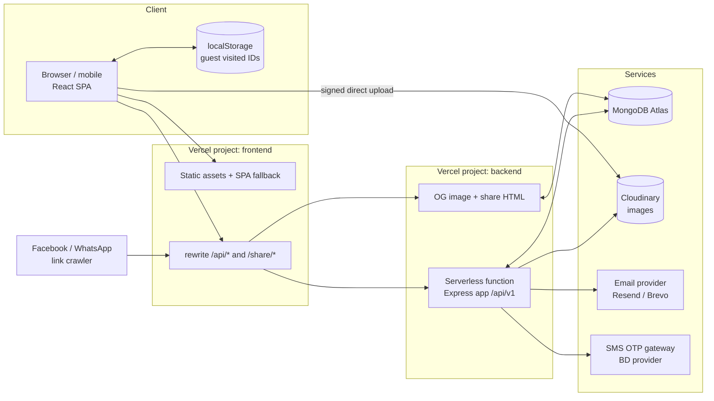
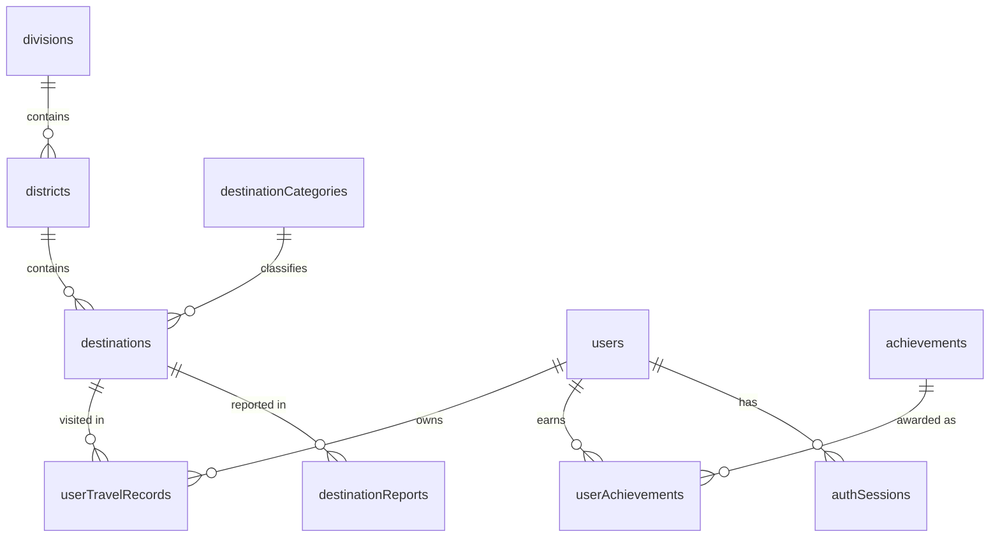
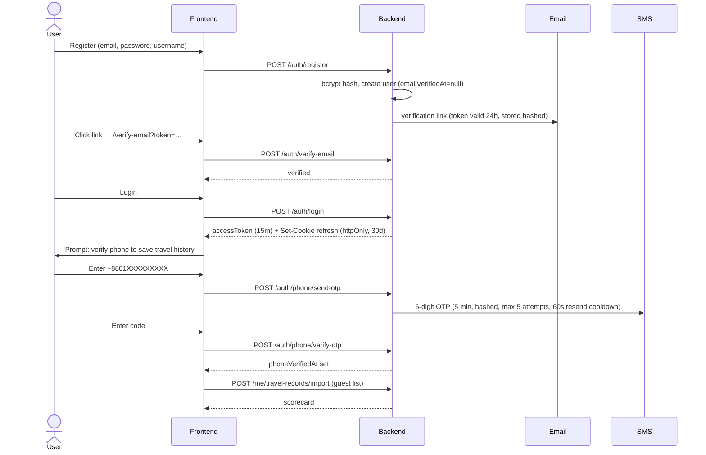

# Explore Bangladesh — Architecture & Implementation Plan

Status: **Draft for approval** · Covers the 10 initial deliverables from the master prompt.
Phase 1 (Foundation) has been implemented alongside this document — see §10.

---

## 0. Key decisions at a glance

| # | Decision | Why |
|---|----------|-----|
| D1 | One Git repo, two independent apps (`frontend/`, `backend/`), deployed as **two Vercel projects** using each project's *Root Directory* setting. No npm workspaces. | Matches the requested structure; each app installs, builds and deploys on its own; nothing shared at build time that could break serverless bundling. |
| D2 | The frontend Vercel project **rewrites `/api/*` to the backend project**. The browser only ever talks to its own origin. | Auth cookies stay first-party (no `SameSite=None` cross-site cookies, which Safari/iOS increasingly block), no CORS preflights in production, one public URL to share. CORS is still configured for local dev and for direct backend access. |
| D3 | All API routes versioned under **`/api/v1`**. | Lets us change contracts later without breaking shared links or old clients. |
| D4 | Express app is built once in `src/app.ts`; **`api/index.ts` exports it for Vercel**, `src/server.ts` calls `listen()` for local dev. | Same code path in dev and production; Vercel's Node runtime accepts an Express app as the handler. |
| D5 | Mongo connection is a **cached promise on `globalThis`**, small pool, `bufferCommands: false`. | Serverless instances are reused between invocations; caching avoids opening a new connection per request and exhausting Atlas M0's connection limit. Disabling buffering makes a DB outage fail fast with a 503 instead of hanging until Vercel's timeout. |
| D6 | **Score is never stored as the source of truth.** It's derived from `userTravelRecords` joined to *active* destinations. A cached copy on the user (`stats`) is recomputed by the server after every write. | Satisfies "calculate from valid records, never trust the client"; the cache makes profiles/leaderboards cheap. |
| D7 | One travel record per (user, destination) — enforced by a **unique compound index** — with **multiple visits stored inside it** (`visits[]`). | The spec wants both "one point per destination" *and* "visit dates / notes / chronological history". Nesting visits satisfies both without breaking the unique index. |
| D8 | Guest scores are computed by the **same server endpoint** (`POST /score/preview`) from a list of IDs held in `localStorage`. | One scoring implementation; guests get validated numbers (unknown/inactive IDs are dropped); nothing is saved server-side. |
| D9 | Access token (JWT, 15 min) kept **in memory**; refresh token (opaque, 30 days) in an **httpOnly, Secure, SameSite=Lax cookie**, stored hashed and **rotated** on every use. | Short-lived bearer tokens limit damage from XSS; httpOnly refresh cookie survives reloads; rotation + reuse detection lets us kill stolen sessions. |
| D10 | Social previews are served by the **backend** (`/share/u/:username` → HTML with Open Graph tags + a generated OG image), not by the SPA. | Facebook/WhatsApp crawlers don't run JavaScript, so a React SPA can't give per-user previews on its own. |
| D11 | Email and SMS behind **provider interfaces** (`EmailProvider`, `OtpProvider`) with a console provider for development. | Bangladesh SMS gateways (e.g. SSL Wireless, BulkSMSBD, Alpha SMS) vary in price and API; swapping should be a config change. |
| D12 | Destination data lives in the **database only**; seed files live in `backend/src/seed/data/`, never in the frontend. | Hard requirement. |

### Small deviations from the brief (please confirm)

1. **Divisions, districts and categories are seeded in Phase 1** (brief puts them in Phase 2). They are fixed reference data and let the landing page show real "Explore by division / category" sections from the database instead of empty placeholders. Destinations themselves remain Phase 2.
2. **Three supporting collections** beyond the nine listed: `authSessions` (refresh tokens), `verificationCodes` (email tokens + phone OTPs) and `destinationReports` (needed for "review reported destination information").
3. **Upazila** is stored on the destination as an embedded `{ name, nameBn }` for now rather than a 495-row collection. It can be promoted to its own collection later without changing the API shape.
4. **Account states**: email-verified users can log in and browse, but travel history is only saved permanently once the phone is verified (per §4 of the brief). Until then they keep using the guest list in the browser, which is imported automatically after phone verification.

---

## 1. Finalized project architecture

```
explore-bangladesh/
├── frontend/                 React 19 + TS + Vite + Tailwind v4 + shadcn/ui conventions
│   ├── src/
│   │   ├── components/       ui/ (shadcn primitives) + feature components
│   │   ├── pages/            route-level screens
│   │   ├── layouts/          RootLayout (header, nav, footer)
│   │   ├── services/         api client + per-resource API modules
│   │   ├── hooks/            TanStack Query hooks (useOverviewStats, …)
│   │   ├── context/          AuthContext, GuestTravelContext (Phase 3/4)
│   │   ├── types/            API response types
│   │   ├── utils/            formatting helpers
│   │   └── lib/              cn() helper for shadcn
│   ├── vercel.json           SPA fallback + /api rewrite to backend
│   └── package.json
│
├── backend/                  Node 22 + Express 5 + TS + Mongoose
│   ├── src/
│   │   ├── config/           env (zod-validated), db connection
│   │   ├── controllers/      thin HTTP handlers
│   │   ├── services/         business logic (score engine, auth, …)
│   │   ├── models/           Mongoose schemas
│   │   ├── routes/           routers mounted under /api/v1
│   │   ├── middleware/       error handler, auth, validation, rate limit
│   │   ├── validators/       zod schemas for request bodies/queries
│   │   ├── utils/            ApiError, asyncHandler, logger
│   │   ├── seed/             seed runner + data/*.json
│   │   ├── app.ts            builds the Express app (no listen)
│   │   └── server.ts         local dev entry (listen)
│   ├── api/index.ts          Vercel serverless entry (exports app)
│   ├── vercel.json
│   └── package.json
├── docs/
├── README.md
└── .gitignore
```

**Layering rule (backend):** route → validator → controller → service → model. Controllers never touch Mongoose directly; services never touch `req`/`res`. This keeps the score engine and auth logic unit-testable without HTTP.

**Dependencies kept deliberately small.** Frontend (Phase 1): react-router 7, @tanstack/react-query, tailwind v4, clsx + tailwind-merge + class-variance-authority (shadcn), lucide-react (icons). react-hook-form + zod + @hookform/resolvers are added in Phase 4 when the first forms appear. Later phases add leaflet/react-leaflet (map) and html-to-image (PNG scorecards). Backend adds: express, mongoose, zod, helmet, cors, express-rate-limit, cookie-parser, jsonwebtoken, bcryptjs, and later cloudinary + an email SDK.

---

## 2. System architecture diagram



Request path in production: `https://explorebd.app/api/v1/...` → frontend project rewrite → backend function → Atlas. One domain for the user, two deployable units for us.

---

## 3. Database schema and relationships

MongoDB Atlas + Mongoose. All documents get `createdAt` / `updatedAt` via `timestamps: true`.



### divisions
| field | type | notes |
|---|---|---|
| name | String, required, unique | "Chattogram" |
| nameBn | String, required | "চট্টগ্রাম" |
| slug | String, unique, indexed | "chattogram" |
| description | String | |
| image | `{ url, publicId }` | Cloudinary |
| order | Number | display order |

### districts
| field | type | notes |
|---|---|---|
| name, nameBn, slug | String | slug unique |
| division | ObjectId → divisions, indexed | |
| location | GeoJSON Point (optional) | district centroid for the map |
| image | `{ url, publicId }` | |

Index: `{ division: 1, name: 1 }`.

### destinationCategories
`name`, `nameBn`, `slug` (unique), `icon` (lucide icon name), `order`, `isActive`.

### destinations
| field | type | notes |
|---|---|---|
| name, nameBn | String, required | |
| slug | String, unique | URL `/destinations/:slug` |
| division | ObjectId → divisions | **denormalized** from district for fast filtering |
| district | ObjectId → districts, required | |
| upazila | `{ name, nameBn }` | see deviation 3 |
| category | ObjectId → destinationCategories, required | |
| shortDescription | String ≤ 200 | |
| description | String | detailed |
| significance | String | historical/cultural |
| visitingInfo | `{ bestTime, openingHours, entryFee, howToReach, tips }` | all strings |
| featuredImage | `{ url, publicId, alt }` | |
| images | `[{ url, publicId, alt }]` | |
| location | GeoJSON `{ type: 'Point', coordinates: [lng, lat] }` | 2dsphere index |
| aliases | [String] | alternative spellings ("Cox's Bazar", "Coxs Bazar") |
| searchText | String | lowercase concat of name, nameBn, aliases — built in a pre-save hook |
| isActive | Boolean, default true | inactive = hidden and not counted |
| isFeatured | Boolean | admin-curated |
| popularity | Number | count of travel records, updated by the score engine |

Indexes: `{ isActive: 1, division: 1 }`, `{ isActive: 1, district: 1 }`, `{ isActive: 1, category: 1 }`, `{ isActive: 1, isFeatured: 1 }`, `{ isActive: 1, popularity: -1 }`, `{ searchText: 1 }`, `{ location: '2dsphere' }`.

**Search (Bengali + English):** Phase 2 uses an escaped, case-insensitive match on `searchText` (works for both scripts; MongoDB's built-in text index has no Bengali stemming). If the directory grows past a few thousand entries, switch to Atlas Search (available on the free tier with a small index quota) behind the same `GET /destinations?q=` contract.

### users
| field | type | notes |
|---|---|---|
| email | String, unique, lowercase | primary login |
| emailVerifiedAt | Date \| null | required to log in |
| passwordHash | String, `select: false` | bcrypt, cost 12 |
| username | String, unique, lowercase, 3–20 `[a-z0-9_]` | public profile URL |
| displayName | String | |
| phone | String, unique sparse | E.164, `+8801XXXXXXXXX` |
| phoneVerifiedAt | Date \| null | required for saving travel history |
| avatar | `{ url, publicId }` | |
| isPublic | Boolean, default true | profile privacy |
| status | `'active' \| 'suspended'` | admin moderation |
| stats | `{ score, districtsExplored, divisionsExplored, achievementLevel, updatedAt }` | **cache**, server-written only |

### userTravelRecords
| field | type | notes |
|---|---|---|
| user | ObjectId → users | |
| destination | ObjectId → destinations | |
| visits | `[{ _id, date, note ≤ 1000, photos: [{ url, publicId }] }]` | ≥ 0 entries; max 50 |
| firstVisitedAt | Date | earliest visit date, or createdAt if none |

Indexes: **`{ user: 1, destination: 1 }` unique**, `{ user: 1, firstVisitedAt: -1 }` (chronological history).

### achievements (configurable milestones)
`key` (unique), `name`, `nameBn`, `description`, `type: 'level' | 'badge'`, `minScore`, `maxScore` (null = open-ended), `criteria` (for badges, e.g. `{ kind: 'division_complete', division: ObjectId }`), `icon`, `order`, `isActive`.
Seeded with the six levels from the brief (Beginner Explorer 1–5 … Master Explorer 101+).

### userAchievements
`user`, `achievement`, `awardedAt`. Unique `{ user: 1, achievement: 1 }`. Used for badges and the "recent achievements" feed; the current *level* is derived from score.

### adminUsers
Separate from `users` (as specified): `email` (unique), `passwordHash`, `name`, `role: 'superadmin' | 'editor'`, `lastLoginAt`, `isActive`. Admin JWTs use a different secret and `aud: 'admin'`, so a user token can never pass admin middleware.

### Supporting collections
- **authSessions**: `user`, `tokenHash` (sha256 of refresh token), `family` (rotation chain id), `expiresAt` (TTL index), `revokedAt`, `userAgent`, `ip`.
- **verificationCodes**: `user`, `purpose: 'email_verify' | 'phone_verify' | 'password_reset'`, `target` (email/phone), `codeHash`, `attempts`, `expiresAt` (TTL index), `consumedAt`.
- **destinationReports**: `destination`, `user` (optional), `message`, `status: 'open' | 'resolved' | 'dismissed'`, `resolvedBy` (admin).

---

## 4. API endpoint specification

Base: `/api/v1`. JSON only. Errors always look like:
```json
{ "success": false, "error": { "code": "VALIDATION_ERROR", "message": "…", "details": [ … ] } }
```
Success: `{ "success": true, "data": …, "meta"?: { page, limit, total, totalPages } }`.

Auth column: — public · G guest-or-user (optional auth) · U user · UP user with verified phone · A admin.

### System
| Method | Path | Auth | Purpose | Phase |
|---|---|---|---|---|
| GET | `/health` | — | liveness + DB state | 1 |
| GET | `/stats/overview` | — | totals: destinations, districts, divisions, categories | 1 |

### Reference data
| GET | `/divisions` | — | list with destination counts | 1 |
|---|---|---|---|---|
| GET | `/divisions/:slug` | — | division + its districts | 2 |
| GET | `/districts?division=` | — | list | 1 |
| GET | `/districts/:slug` | G | district + destinations (+ visited flags if user) | 2 |
| GET | `/categories` | — | list with counts | 1 |

### Destinations
| GET | `/destinations` | G | `?q=&division=&district=&category=&visited=true\|false&page=&limit=` (limit ≤ 50) | 2 |
|---|---|---|---|---|
| GET | `/destinations/featured` | — | featured list | 2 |
| GET | `/destinations/popular` | — | by popularity | 2 |
| GET | `/destinations/:slug` | G | detail | 2 |
| POST | `/destinations/:id/reports` | G | report wrong info (rate-limited) | 7 |

`visited` filtering for guests is done client-side from localStorage; for users server-side.

### Score engine
| POST | `/score/preview` | — | body `{ destinationIds: string[] ≤ 2000 }` → full scorecard for guests | 3 |
|---|---|---|---|---|
| GET | `/me/score` | U | scorecard from saved records | 3/4 |

Scorecard shape:
```json
{
  "score": 25, "totalDestinations": 500, "percentage": 5.0,
  "districtsExplored": 8, "totalDistricts": 64,
  "divisionsExplored": 3, "totalDivisions": 8,
  "byDivision": [{ "id": "…", "name": "Sylhet", "visited": 6, "total": 40 }],
  "byDistrict": [{ "id": "…", "name": "Sylhet", "visited": 4, "total": 12 }],
  "byCategory": [{ "id": "…", "name": "Waterfalls", "visited": 2, "total": 18 }],
  "level": { "key": "travel_enthusiast", "name": "Travel Enthusiast", "next": { "name": "Bangladesh Explorer", "minScore": 31 } }
}
```

### Auth
| POST | `/auth/register` | — | email, password, displayName, username → sends verification email | 4 |
|---|---|---|---|---|
| POST | `/auth/verify-email` | — | `{ token }` | 4 |
| POST | `/auth/resend-verification` | — | rate-limited | 4 |
| POST | `/auth/login` | — | → access token + sets refresh cookie | 4 |
| POST | `/auth/refresh` | cookie | rotates refresh token | 4 |
| POST | `/auth/logout` | cookie | revokes session | 4 |
| POST | `/auth/forgot-password` | — | email link (or SMS once phone verified) | 4 |
| POST | `/auth/reset-password` | — | | 4 |
| POST | `/auth/phone/send-otp` | U | `{ phone }` BD format only | 4 |
| POST | `/auth/phone/verify-otp` | U | `{ code }` | 4 |

### Current user
| GET | `/me` | U | profile + stats | 4 |
|---|---|---|---|---|
| PATCH | `/me` | U | displayName, username, isPublic | 4 |
| POST | `/me/avatar/sign` | U | Cloudinary signed-upload params | 4 |
| GET | `/me/travel-records` | U | chronological, paginated | 4 |
| PUT | `/me/travel-records/:destinationId` | UP | idempotent "mark visited" (upsert) | 4 |
| DELETE | `/me/travel-records/:destinationId` | UP | unmark | 4 |
| POST | `/me/travel-records/import` | UP | `{ destinationIds }` — guest list → account | 4 |
| POST | `/me/travel-records/:destinationId/visits` | UP | add visit `{ date, note }` | 4 |
| PATCH/DELETE | `/me/travel-records/:destinationId/visits/:visitId` | UP | edit/delete a visit | 4 |

Every `/me/*` route takes the user id **from the verified token only** — there is no route that accepts a userId for writing, which is how rule 10 (no manipulating another user's data) is enforced structurally.

### Public profiles & sharing
| GET | `/users/:username` | — | public profile + scorecard (404 if private) | 5 |
|---|---|---|---|---|
| GET | `/share/u/:username` | — | HTML with OG tags, redirects humans to the SPA | 5 |
| GET | `/og/u/:username.png` | — | 1200×630 OG image | 5 |
| GET | `/achievements` | — | level definitions | 6 |
| GET | `/leaderboard?scope=all\|division` | — | optional, public profiles only | 6 |

### Admin (`/admin/*`, admin JWT)
`POST /admin/auth/login` · CRUD `/admin/destinations`, `/admin/divisions`, `/admin/districts`, `/admin/categories`, `/admin/achievements` · `GET/PATCH /admin/users` (suspend) · `GET /admin/stats` · `PATCH /admin/destinations/:id/featured` · `GET/PATCH /admin/reports` · `POST /admin/uploads/sign`. Phase 7.

---

## 5. Frontend page and component structure

### Routes
| Path | Page | Phase |
|---|---|---|
| `/` | HomePage — hero, score summary, totals, featured, popular, divisions, categories, CTA | 1 (shell + real totals), filled in 2–6 |
| `/explore` | ExplorePage — search, filters, paginated grid, visited toggle | 2 |
| `/destinations/:slug` | DestinationDetailPage | 2 |
| `/divisions` | DivisionsPage — map + division cards | 2 |
| `/divisions/:slug` | DivisionPage — districts with completion | 2/3 |
| `/districts/:slug` | DistrictPage — destinations, visited/unvisited, completion | 2/3 |
| `/scorecard` | ScorecardPage — full stats + share | 3/5 |
| `/history` | TravelHistoryPage (protected) | 4 |
| `/login`, `/register`, `/verify-email`, `/verify-phone`, `/forgot-password`, `/reset-password` | Auth pages | 4 |
| `/settings/profile` | ProfileSettingsPage (protected) | 4 |
| `/u/:username` | PublicProfilePage | 5 |
| `/admin/*` | Separate lazy-loaded admin bundle with its own layout | 7 |
| `*` | NotFoundPage | 1 |

### Component tree (main pieces)
```
RootLayout
├── SiteHeader (logo, NavLinks, ScoreChip, AuthMenu, MobileNav sheet)
├── <Outlet/>
└── SiteFooter

HomePage
├── HeroSection
├── ScoreSummary          (StatCard ×4, ProgressRing)
├── FeaturedDestinations  (DestinationCard grid)
├── PopularDestinations
├── DivisionGrid          (DivisionCard)
├── CategoryGrid          (CategoryChip)
├── RecentAchievements
└── CallToAction

ExplorePage
├── SearchBar (debounced)
├── FilterBar (DivisionSelect → DistrictSelect, CategorySelect, VisitedTabs)
├── DestinationGrid → DestinationCard → VisitedToggle
└── Pagination

Shared: ui/Button, ui/Card, ui/Badge, ui/Input, ui/Select, ui/Sheet, ui/Skeleton,
        EmptyState, ErrorState, LoadingGrid, SectionHeading, Container
```

### State
- **Server state:** TanStack Query only (no Redux). Query keys: `['stats','overview']`, `['destinations', filters]`, `['score', 'me' | guestHash]`.
- **Guest visited list:** `GuestTravelContext` backed by `localStorage` key `eb.visited.v1` (array of destination IDs; versioned key so the format can change).
- **Auth:** `AuthContext` holds the access token in memory; on load it calls `/auth/refresh` to restore a session from the cookie. API client retries once after a 401 by refreshing.
- **Visited toggle** is one hook, `useVisited()`, that writes to localStorage for guests and calls `PUT/DELETE /me/travel-records/:id` (with optimistic update) for phone-verified users — components don't know which mode they're in.

---

## 6. Authentication workflow



Rules:
- Passwords: min 8 chars, bcrypt cost 12. Login errors never reveal whether the email exists.
- Access JWT payload: `{ sub, ev (emailVerified), pv (phoneVerified) }`, HS256, `iss: explore-bangladesh`, `aud: user`, 15 min.
- Refresh: 256-bit random, only sha256 stored; rotated on each `/auth/refresh`; presenting an already-rotated token revokes the whole family (theft detection).
- Rate limits: login 10/15 min per IP+email; OTP send 3/hour per user and per phone; register 5/hour per IP.
- Phone format: Bangladesh mobile only — `^\+8801[3-9]\d{8}$`, normalized from `01XXXXXXXXX`.
- Account recovery: email link always; SMS OTP option once the phone is verified.

---

## 7. Travel score calculation logic

**Definition.** For user U:
`score(U) = | { d ∈ destinations : d.isActive ∧ ∃ record(U, d) } |`

Because `(user, destination)` is unique in `userTravelRecords`, duplicate points are impossible at the database level; "visit again" adds to `visits[]` and leaves the score unchanged.

**Denominators** are counts of *active* destinations (overall, per district, per division, per category). If an admin deactivates a destination, it drops out of both numerator and denominator, so percentages stay ≤ 100 % and nobody's data is deleted — reactivating restores it.

- `percentage = round(score / totalActive × 100, 1)` (0 when totalActive = 0)
- `districtsExplored` = distinct districts among the user's counted destinations
- `divisionsExplored` = distinct divisions likewise
- `level` = the active `achievements` row of type `level` whose `[minScore, maxScore]` contains `score` (0 points → no level, "Start exploring")

**Implementation.** One service, `scoreService.compute(destinationIds: ObjectId[])`:
1. `$match { _id: { $in: ids }, isActive: true }` on destinations, `$facet` into counts by division/district/category.
2. A cached (60 s, in-memory per instance) facet of totals over all active destinations.
3. Merge into the scorecard shape in §4.

Guests call it with their localStorage IDs (invalid/inactive IDs silently dropped and reported back as `ignoredIds` so the client can clean its list). Users call it with IDs loaded from their records. After any write to a user's records, the server recomputes and stores `users.stats` and adjusts `destinations.popularity` (`$inc` ±1, only on insert/delete, not on extra visits). **The client never sends a score.**

**Achievements.** After recomputing, compare the new level/badges with `userAchievements`; insert any newly earned ones (unique index makes this idempotent) — these feed "Recent travel achievements".

---

## 8. Vercel deployment strategy

| | Frontend project | Backend project |
|---|---|---|
| Root Directory | `frontend` | `backend` |
| Framework preset | Vite | Other |
| Build | `npm run build` → `dist/` | none needed (Vercel compiles `api/*.ts`) |
| Config | `vercel.json`: rewrite `/api/(.*)` and `/share/(.*)` to the backend URL, then SPA fallback to `/index.html` | `vercel.json`: rewrite everything to `/api` so Express handles routing |
| Env vars | `VITE_API_BASE_URL=/api/v1` (only public values — anything `VITE_*` is shipped to browsers) | `MONGODB_URI`, `JWT_ACCESS_SECRET`, `JWT_REFRESH_SECRET`, `ADMIN_JWT_SECRET`, `CORS_ORIGINS`, `APP_URL`, `CLOUDINARY_*`, `EMAIL_*`, `SMS_*` |

Atlas setup: M0 cluster in a region near Vercel's function region (e.g. Atlas `ap-south-1` Mumbai with Vercel function region `bom1`, or both in Singapore) to keep latency low. Network access must allow Vercel's dynamic IPs (`0.0.0.0/0` on free tiers — compensate with a strong DB user password and least-privilege DB user scoped to one database).

Serverless specifics:
- Cached connection (D5), `maxPoolSize: 5`, `serverSelectionTimeoutMS: 5000`.
- **Rate limiting:** the in-memory store resets per instance, so in production it's best-effort only. Phase 8 swaps in a shared store (Upstash Redis free tier or a Mongo-backed store) behind the same middleware.
- Preview deployments get their own `MONGODB_URI` pointing at a separate database so previews never touch production data.
- Migration path: the Express app is plain Node, so moving to Render/Railway/a VPS later is `node dist/server.js` with no code changes; Atlas scales by changing tier.

---

## 9. Development roadmap

| Phase | Scope | Exit criteria (tested) |
|---|---|---|
| **1 Foundation** ✅ built | Repo, both apps, env validation, DB connection, error handling, security middleware, reference-data models + seed (divisions, districts, categories), `/health`, `/stats/overview`, `/divisions`, `/districts`, `/categories`, responsive layout, landing page wired to API with loading/empty/error states | Both apps typecheck + build; API responds; landing page renders against API |
| 2 Destinations | Destination model finalized, curated seed for all 64 districts (with sources noted for review), explorer with search/filters/pagination, detail page, division/district pages, map (Leaflet + OSM, district GeoJSON) | Search works in both scripts; filters combine; pagination stable |
| 3 Score engine | `scoreService`, `/score/preview`, guest localStorage flow, scorecard page, district/division completion | Unit tests for score edge cases (duplicates, inactive, empty) |
| 4 Auth | Register, email verification, login, refresh rotation, phone OTP, profile, persistent history with visits, guest import | Integration tests for auth flows + authorization (cannot touch other users) |
| 5 Sharing | Scorecard PNG (html-to-image), Web Share API, WhatsApp/Facebook links, public profiles, OG HTML + image | OG preview verified with Facebook Sharing Debugger |
| 6 Gamification | Configurable levels, badges, achievements feed, optional leaderboard | Level boundaries tested |
| 7 Admin | Separate admin auth, CRUD, uploads, users, reports, stats | Role checks tested |
| 8 Production | Test pass, security review, shared rate-limit store, perf (indexes, image transforms, code splitting), deployment docs | Lighthouse ≥ 90 mobile on home; no high-severity audit findings |

---

## 10. Stage 1 implementation checklist

- [x] Root: `README.md`, `.gitignore`, `docs/ARCHITECTURE.md`
- [x] Backend: TypeScript config, scripts (`dev`, `build`, `typecheck`, `seed`, `start`)
- [x] Backend: zod-validated environment config (fails fast with a clear message)
- [x] Backend: serverless-safe cached Mongo connection
- [x] Backend: `ApiError`, `asyncHandler`, 404 + central error handler (zod, Mongoose cast/duplicate, JSON parse errors mapped to clean responses)
- [x] Backend: helmet, CORS allow-list, JSON body limit, rate limiter, `x-powered-by` off
- [x] Backend: models — Division, District, DestinationCategory, Destination (schema per §3; data in Phase 2)
- [x] Backend: seed — 8 divisions, 64 districts (English + Bengali), 13 categories; idempotent upserts
- [x] Backend: `/api/v1/health`, `/stats/overview`, `/divisions`, `/districts`, `/categories`
- [x] Backend: `api/index.ts` + `vercel.json` for serverless; `src/server.ts` for local
- [x] Frontend: Vite + React + TS, Tailwind v4 with brand tokens (green primary, flag-red accent), shadcn conventions (`cn`, Button, Card, Badge, Skeleton)
- [x] Frontend: React Router with RootLayout, responsive header with mobile menu, footer, 404
- [x] Frontend: TanStack Query provider + typed API client
- [x] Frontend: landing page — hero, score summary (guest zero-state), live totals, divisions + categories from API, featured/popular placeholders for Phase 2, CTA; loading/empty/error states
- [x] Frontend: `vercel.json` (SPA fallback + `/api` rewrite)
- [x] Typecheck + production build of both apps; API exercised against a real MongoDB 7 (seed ×2 idempotent, all endpoints, validation/404/bad-JSON errors, CORS allow/deny, DB-down → 503 and recovery, Vercel entry); landing page rendered at desktop and mobile widths with no console errors
- [ ] **You:** create Atlas cluster, put `MONGODB_URI` in `backend/.env`, run `npm run seed` (see README)
